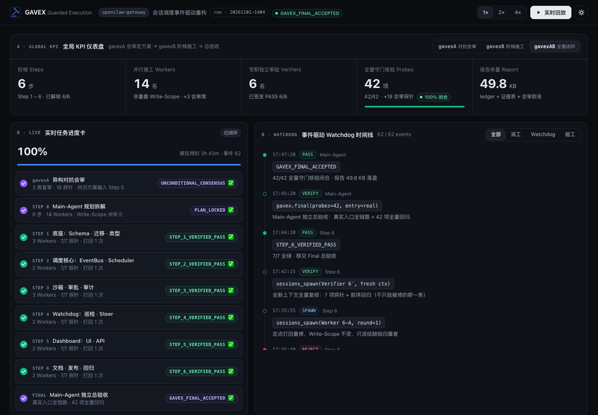
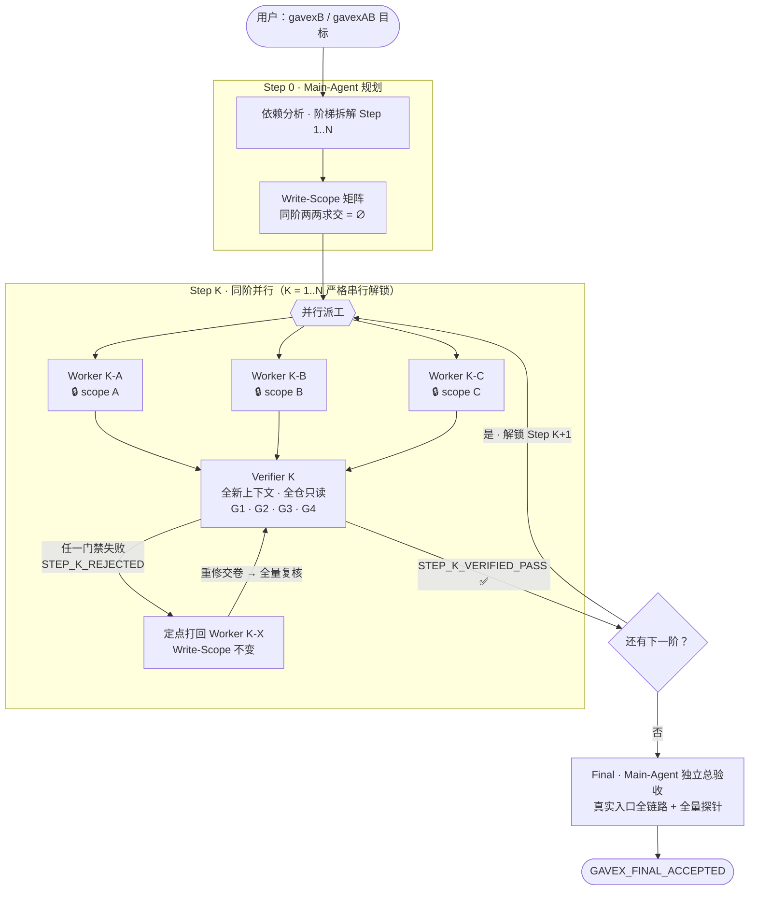
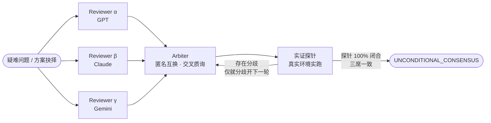
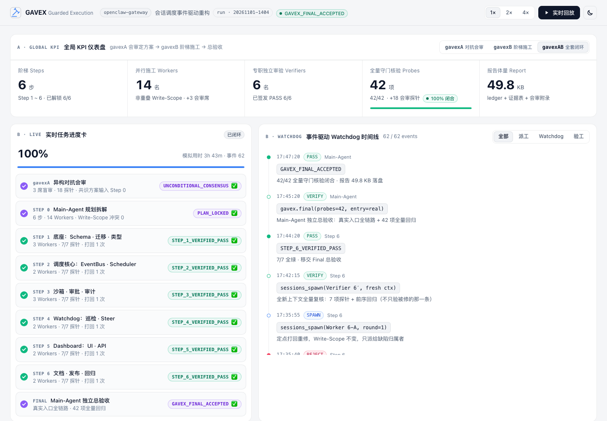

# GAVEX


[](./LICENSE)

**G**uarded **A**udit & **V**erifier-gated **EX**ecution

**让子代理在互斥边界内并行施工，让独立守门员握着法槌一票否决**

*Parallel workers build inside guarded scopes. An independent verifier holds the gavel.*

阶梯门禁并行施工 · 异构对抗会审 · 独立守门员验工


[官网 / Website](docs/index.html) · [Skill 协议](SKILL.md) · [实时看板](docs/dashboard/index.html) · [架构说明](ARCHITECTURE.md)




---

## 目录

- [项目定位](#项目定位)
- [为什么需要 GAVEX](#为什么需要-gavex)
- [核心工作流](#核心工作流)
- [与普通 Sub-agent 调度的本质对比](#与普通-sub-agent-调度的本质对比)
- [快速安装](#快速安装)
- [呼出指令](#呼出指令)
- [四大一票否决门禁](#四大一票否决门禁)
- [Write-Scope 防踩踏规范](#write-scope-防踩踏规范)
- [Dashboard 预览](#dashboard-预览)
- [为什么叫 GAVEX？（设计哲学与命名拆解）](#为什么叫-gavex设计哲学与命名拆解)
- [仓库结构](#仓库结构)

---

## 项目定位

**GAVEX**（Guarded Audit & Verifier-gated EXecution）是一套与业务形态无关的**多智能体执行协议**，以单文件 [`SKILL.md`](SKILL.md) 的形式发布，可直接安装到 OpenClaw、Claude Code、OpenCode、Pi、DSH、Hermes 等任何支持 Skill 的 Agent 运行时。

它只做一件事：**把"一个 Agent 派一群子代理干活"变成一条可验证、可追溯、零回归的流水线。**

| 你得到的 | 说明 |
| --- | --- |
| **阶梯门禁**（Stage Gates） | Main-Agent 把工程拆成 `Step 1 → Step N`；前一阶没拿到 `STEP_K_VERIFIED_PASS`，后一阶一律锁定 |
| **非重叠并行**（Disjoint Write-Scopes） | 同一阶内 `Worker K-A / K-B / K-C` 并行施工，各自的写入白名单两两求交为空；A/B/C 仅为示例，Worker 数由独立任务数决定 |
| **专职独立验工**（Independent Verifier） | 每阶唤醒全新上下文、只读的 `Verifier K`，执行四大一票否决门禁，有瑕疵就定点打回 |
| **对抗会审**（Adversarial Cross-Audit） | `gavexA` 模式下 3 个异构模型盲审 + 交叉质询 + 实证探针闭合，收敛到 `UNCONDITIONAL_CONSENSUS` |
| **可视化看板**（Dashboard） | 单文件 HTML：KPI、实时进度卡、Watchdog 时间线、双栏门禁泳道，可回放、可模拟打回重修 |

---

## 为什么需要 GAVEX

传统"单 Agent + 一批 Sub-agents"的派工方式，几乎必然撞上三类灾难：

1. **一锅端大爆炸** —— 十几个模块塞进一个巨型任务同时放出；底座没稳，后续模块全在错误假设上盲改。
2. **并发踩踏（Write-Scope Collision）** —— 多个 Worker 同时修改同一个文件、争抢同一个全局状态锁，互相覆盖。
3. **运动员兼裁判（Self-Grading Hallucination）** —— Worker 跑个假测试就宣称"100% 完成"，主代理当传声筒转述给用户，一跑全崩。

GAVEX 的回答是三条结构性约束：**阶梯扣留**、**Write-Scope 互斥**、**验工与施工物理隔离**。

---

## 核心工作流

### Mode B · 阶梯门禁并行施工（`gavexB`）



### Mode A · 3+1 异构对抗会审（`gavexA`）



`gavexAB` = 先跑 Mode A 得出被共识的方案，再把方案作为 Mode B 的 Step 0 输入。`gavex` 默认等同于 `gavexB`。

图中的 3 名 Worker 与 3+1 会审是默认示例，不是架构上限：工程按依赖拆成 `Step 1..N`，同阶可安排 `2..M` 个互不冲突的 Worker（不超过 `--max-workers`），不可并行的工作串行处理。

### 事件驱动 Watchdog

| 机制 | 行为 |
| --- | --- |
| 事件驱动等待 | `wait(ids)` 挂起，等子代理完成事件唤醒，**零忙轮询** |
| 5 分钟低频巡检 | 只看落盘痕迹（文件 mtime、台账、最新输出），不打断 |
| 停滞判定 | 连续 2 次巡检无新落盘 → 停滞 |
| Steer 收拢 | `停止扩张范围，提交已落盘成果与阻塞证据，立即交卷。` |
| 越界拦截 | 发现 Write-Scope 外写入 → steer 回滚并记账，Verifier 必查 |

---

## 与普通 Sub-agent 调度的本质对比

| 维度 | 普通 Sub-agent 调度 | **GAVEX** |
| --- | --- | --- |
| 任务拆分 | 一次性全部派出 | `Step 1..N` 依赖阶梯，严格按序解锁 |
| 并发安全 | 无写入边界，互相覆盖 | 非重叠 Write-Scope 白名单，越界即否决 |
| 验收主体 | Worker 自评，主代理转述 | 专职独立 Verifier，全新上下文、只读、真实入口实跑 |
| 验收标准 | "测试通过了" | 四大一票否决门禁 G1–G4 + 前序全量回归 |
| 缺陷处理 | 交付后由用户发现 | `STEP_K_REJECTED` → 定点打回 Worker K-X → 全量复核 |
| 等待方式 | `sleep` 轮询或无限等待 | 事件驱动 + 5 分钟低频巡检 + Steer 收拢 |
| 状态表达 | 自然语言"差不多好了" | 机器可解析的判定令牌（`STEP_K_VERIFIED_PASS` 等） |
| 可追溯性 | 散落在对话里 | `.gavex/ledger.md` 台账 + 可视化 Dashboard |
| 疑难问题 | 单模型拍脑袋 | `gavexA` 3 席异构盲审 + 探针闭合共识 |

---

## 快速安装

GAVEX 是一个单文件 Skill，只依赖每个运行时都具备的 **spawn / wait / run** 三种原语。把安装命令中的 `GAVEX_OWNER` 设为实际发布的 GitHub 账号即可；Pages 地址中的 `<owner>` 同理。

| 平台 | 推荐安装路径 |
| --- | --- |
| OpenClaw | `~/.openclaw/skills/gavex/SKILL.md`（或工作区 `skills/gavex/SKILL.md`） |
| Claude Code | `~/.claude/skills/gavex/SKILL.md`（或项目 `.claude/skills/gavex/SKILL.md`） |
| OpenCode | `~/.config/opencode/skills/gavex/SKILL.md`（或项目 `.opencode/skills/gavex/SKILL.md`） |
| Pi | `~/.pi/agent/skills/gavex/SKILL.md` |
| DSH | 平台配置的 skills 目录下 `gavex/SKILL.md` |
| Hermes | `~/.hermes/skills/gavex/SKILL.md` |

**方式一：curl 单文件安装**（以 Claude Code 为例，其他平台替换目录即可）

```bash
GAVEX_OWNER="your-github-account"  # 替换为实际发布账号
mkdir -p ~/.claude/skills/gavex
curl -fsSL "https://raw.githubusercontent.com/${GAVEX_OWNER}/GAVEX/main/SKILL.md" \
  -o ~/.claude/skills/gavex/SKILL.md
```

**方式二：git clone + 软链接**（`git pull` 即可升级）

```bash
GAVEX_OWNER="your-github-account"  # 替换为实际发布账号
mkdir -p ~/Developer ~/.openclaw/skills ~/.claude/skills \
  ~/.config/opencode/skills ~/.pi/agent/skills ~/.hermes/skills
git clone "https://github.com/${GAVEX_OWNER}/GAVEX.git" ~/Developer/GAVEX

ln -sfn ~/Developer/GAVEX ~/.openclaw/skills/gavex          # OpenClaw
ln -sfn ~/Developer/GAVEX ~/.claude/skills/gavex            # Claude Code
ln -sfn ~/Developer/GAVEX ~/.config/opencode/skills/gavex   # OpenCode
ln -sfn ~/Developer/GAVEX ~/.pi/agent/skills/gavex          # Pi
ln -sfn ~/Developer/GAVEX ~/.hermes/skills/gavex            # Hermes
```

> 平台没有子代理能力时，GAVEX 自动降级为**单 Agent 串行模式**：仍按 Step 推进并以“审验员”身份自我复核，在报告中标注 `degraded: single-agent`；这不等同于独立上下文的物理隔离，必须披露其保证较弱。详见 [SKILL.md §9](SKILL.md#9-平台适配platform-adapters)。

---

## 呼出指令

| 指令 | 模式 | 适用场景 | 结束令牌 |
| --- | --- | --- | --- |
| `gavex <目标>` | 默认 Mode B（同 `gavexB`） | 已有目标，需要规划与受控施工 | `GAVEX_FINAL_ACCEPTED` |
| `gavexA <问题>` | 3+1 异构对抗会审 | 疑难 Bug 根因、架构抉择、事故复盘 | `UNCONDITIONAL_CONSENSUS` |
| `gavexB <目标>` | 阶梯门禁并行施工 | 多模块重构、新功能、迁移与发布加固 | `GAVEX_FINAL_ACCEPTED` |
| `gavexAB <目标>` | 全套闭环 | 方案未定 + 施工量大的高风险工程 | `GAVEX_FINAL_ACCEPTED` |

```text
gavex   补齐会话审计日志并逐阶验收
gavexA  为什么 Gateway 在 200 并发会话下会重复派工？
gavexB  补齐 Dashboard 面板与数据接口 --max-workers=3 --patrol=5m
gavexAB 把 Gateway 会话调度重构为事件驱动 --steps=auto --max-rework=3
gavexB  拆分支付模块 --dry          # 只输出阶梯计划与 Write-Scope 矩阵，不派工
```

| 参数 | 默认 | 说明 |
| --- | --- | --- |
| `--steps` | `auto` | 阶梯数，由依赖分析决定（建议 3–8） |
| `--max-workers` | `3` | 每阶并行 Worker 上限，可按需设为 M；K-A / K-B / K-C 只是命名示例 |
| `--max-rework` | `3` | 每阶打回上限，超限签发 `GAVEX_ESCALATED` 交给用户 |
| `--patrol` | `5m` | Watchdog 低频巡检间隔 |
| `--ledger` | `.gavex/ledger.md` | 施工台账路径 |
| `--dry` | — | 只规划不派工 |

### 判定令牌

| 令牌 | 签发者 | 含义 |
| --- | --- | --- |
| `STEP_K_VERIFIED_PASS` | Verifier K | 全部探针与门禁通过，解锁 Step K+1 |
| `STEP_K_REJECTED` | Verifier K | 存在缺陷，附缺陷清单与 Worker 归属 |
| `UNCONDITIONAL_CONSENSUS` | Arbiter | gavexA 会审在探针闭合下达成无条件共识 |
| `GAVEX_FINAL_ACCEPTED` | Main-Agent | 全流程总验收通过，可以交付 |
| `GAVEX_ESCALATED` | Main-Agent | 重修超限或范围冲突无法自决，升级给用户 |

---

## 四大一票否决门禁

| 门禁 | 名称 | 判定标准 |
| --- | --- | --- |
| **G1** | 真实入口 · 拒绝白盒注入 | 必须从 CLI / HTTP / UI / 公开 API 端到端触发；禁止改内存状态、mock 被测对象或手写假数据当证据 |
| **G2** | 多视口 × 深浅色真实渲染 | 涉及前端：≥ 3 个视口 × 深浅两色真实渲染截图，核验溢出、几何对齐、对比度与控制台报错 |
| **G3** | Dry-run 零破坏 | 涉及配置 / 数据库 / 迁移 / 外部服务：先干跑并对比前后快照，确认无破坏性写入 |
| **G4** | 需求不缩水 | 原始需求与证据逐条映射；"先跳过""改成 TODO""降级为占位"一律判定失败 |

复核必须**全量重跑**（全部探针 + G1–G4 + 前序 Step 回归），不能只验被修的那一条。

---

## Write-Scope 防踩踏规范

```text
for each Step K:
  for each pair (Worker K-X, Worker K-Y), X ≠ Y:
    glob(K-X.scope) ∩ glob(K-Y.scope) ≠ ∅          → COLLISION   重新拆分
    scope 含 lockfile / 全局配置 / 迁移序号目录     → 只能归属唯一 Worker
    K-X 需要读取 K-Y 本阶的产出                    → DEPENDENCY  移到 Step K+1
```

1. **白名单制** —— 只列允许写入的路径，其余一律只读。
2. **同阶互斥** —— 同一 Step 内任意两个 Worker 的 Write-Scope 交集必须为空。
3. **热点文件唯一归属** —— `package.json`、lockfile、全局配置、路由注册表、迁移序号目录、i18n 总表只能分给一个 Worker；其他人写出补丁意图，由归属者或下一阶合入。
4. **生成物隔离** —— 构建产物、快照、缓存不进入任何 Write-Scope，由 Verifier 现场生成。
5. **越界即否决** —— Verifier 以 `git diff --name-only`（或 mtime 快照）为准，越界改动无论好坏都打回。
6. **跨阶可重叠** —— Step K+1 可以改写 Step K 的文件，因为 Step K 已封版通过。

Worker 派单模板示例：

```markdown
[GAVEX Worker Brief] Worker 1-B · 持久化迁移
- Mode: gavexB · Step 1/6 · Rework round: 0
- Write-Scope (ONLY these paths):
  - migrations/0042_session_events.sql
  - src/storage/sessionStore.ts
- Acceptance probes (Verifier 1 will run each):
  1. `node scripts/migrate.js --dry-run` → 0 destructive DDL
  2. `sqlite3 .dump` 前后快照 diff → 0 rows lost
- Rules: 增量落盘；越界需求停止并上报；交卷只写改动清单 / 自测命令与真实输出 / 未决风险。
```

---

## Dashboard 预览

[`docs/dashboard/index.html`](docs/dashboard/index.html) 是一个**单文件、零依赖**的可交互看板，直接用浏览器打开即可。

| 组件 | 内容 |
| --- | --- |
| **A · 全局 KPI** | 6 步 · 14 名并行 Workers · 6 名独立 Verifiers · 42 项全量守门核验（100% 闭合）· 49.8 KB 报告；`gavexA` / `gavexB` / `gavexAB` 模式切换 |
| **B · 实时进度卡 + Watchdog 时间线** | Step 0 → Step 6 → Final 勾选进度、`STEP_K_VERIFIED_PASS ✅` 印章、旋转进行中图标；SPAWN / WAIT / PATROL / STEER / VERIFY / REJECT / PASS 事件流 |
| **C · 双栏阶梯门禁泳道** | 每个 Step 可折叠；左栏蓝色 Worker 卡（模型角标、🔒 Write-Scope 白名单、施工条目、互斥校验）；右栏翡翠色 Verifier 卡（G1–G4、实跑探针证据、🛠️ 打回重修闭环） |

交互：深浅色切换、步骤 / 状态筛选、全部折叠 / 展开、`1× / 2× / 4×` 实时回放，以及每个 Step 的 **「▶ 模拟打回与重修流转」**——逐条跑探针 → 命中缺陷盖 `STEP_K_REJECTED` → 对应 Worker 卡转琥珀并重修 → 全量复核 → 盖 `STEP_K_VERIFIED_PASS` 解锁下一步，全过程同步写入时间线。

URL 参数：

| 参数 | 示例 | 作用 |
| --- | --- | --- |
| `mode` | `?mode=gavexB` | 初始模式：`gavexA` / `gavexB` / `gavexAB`（默认） |
| `theme` | `?theme=light` | 强制深 / 浅色 |
| `replay` | `?replay=0` | 关闭打开页面时的自动回放，直接展示终态 |




### GitHub Pages

官网位于 [`docs/index.html`](docs/index.html)（中 / 英双语、深浅色、交互式工作流沙盘、6 平台安装指南、内嵌看板实时预览）。发布步骤：

1. 仓库 **Settings → Pages → Build and deployment**，Source 选 `Deploy from a branch`，分支 `main`，目录 `/docs`；
2. 访问 `https://<owner>.github.io/GAVEX/`——页面会根据域名自动把安装命令中的 `<owner>` 替换为真实账号，且可直接点开 [`docs/dashboard/index.html`](docs/dashboard/index.html) 实时看板。

---

## 为什么叫 GAVEX？（设计哲学与命名拆解）

### 1. 挣脱“数字 3”的束缚

早期以“三方”为名，强调的是多模型相互校验；但名字不该把工程架构钉死在某个数字上。真实项目的依赖阶梯可以是 `Step 1..N`，同阶并行 Worker 可以是 `2..M` 个：小任务两人拆开写，大工程按互斥边界扩展，阶梯数与施工人数都由问题决定。`--max-workers=3` 与 Mode A 的 3+1 会审只是默认配置，不是项目身份。

真正永恒不变的，不是“三”，而是**施工者与守门员的物理隔离**和**逐阶互锁**。Worker 的自测只是交卷材料，不能代替裁决；前一阶没有独立签发的 `STEP_K_VERIFIED_PASS`，后一阶就没有开工资格。GAVEX 因此用架构约束命名，而不再用参与者数量命名。

### 2. 5 个字母装下四大架构支柱（The Four Pillars in 5 Letters）

- **`G` — Guarded Write-Scopes（受控互斥写入域）**：同阶 Worker 的写入白名单两两求交为空：$S_i \cap S_j = \emptyset$（$i \ne j$）。白名单之外一律只读，lockfile、全局配置等热点路径必须唯一归属；相互依赖的产出移到下一阶。从派工前就消灭并发踩踏，而不是在合并冲突后补救。
- **`A` — Adversarial Cross-Audit（异构对抗盲审）**：`gavexA` 让多模型在互不可见的上下文里独立盲审，再匿名交叉质询，并把分歧变成真实环境可执行的实证探针。没有探针闭合的“一致”只是相同偏见，只有证据闭合后才签发 `UNCONDITIONAL_CONSENSUS`。
- **`V` — Verifier Veto Gates（独立守门员一票否决）**：**写代码的绝不审代码**。全新上下文、全仓只读的 `Verifier K` 执掌 G1–G4 四道硬门禁；任一道失败，就签发 `STEP_K_REJECTED` 并定点打回。Verifier 不是替 Worker 润色交卷词的助手，而是有权阻断整阶的独立裁判。
- **`EX` — Execution Pipeline（阶梯式解锁执行流）**：`Step 1 → Step N` 像棘轮一样推进，前一阶未拿到 `STEP_K_VERIFIED_PASS` 绝不解锁后一阶。重修后必须重跑全部探针、G1–G4 与前序回归；全部阶梯通过后仍须独立总验收，才有 `GAVEX_FINAL_ACCEPTED`。`EX` 是一个整体，而不是另造第五根支柱。

全称 **G**uarded **A**udit & **V**erifier-gated **EX**ecution，把“受控审计”与“经独立验证才放行的执行”压进五个字母：并行是效率来源，边界、对抗证据和否决权才是可信来源。

### 3. 词源意象：Gavel 法槌 + Execution 执行

GAVEX 发音为 **/ˈɡæv.eks/**，是 **Gavel（法槌）+ Execution（执行）** 的命名意象，而不是已有词汇的词典释义。它要表达的是：**没有独立裁判敲下法槌（Gavel），任何子代理的自吹自擂都不算数**。

“做完了”不等于“可以交付”：法槌要落在命令、真实退出码、截图、快照与需求映射这些可追溯证据上，绝不落在 Worker 的信心上。遇到重修超限或边界冲突，`GAVEX_ESCALATED` 明确把决定权交回用户，也好过制造一个虚假的绿色终态。

最后是一个工程师的小偏爱：在标准 QWERTY 键盘上，`g-a-v-e-x` 五个字母全在左手热区，**单手半秒即可盲打呼出**是命名追求的手感，而非对所有用户的测速承诺。从呼出到裁决，名字提醒的始终是同一件事：**并行施工，独立落槌。**

---

## 仓库结构

```text
GAVEX/
├── SKILL.md                 # 可安装的通用 Skill 协议（gavexA / gavexB / gavexAB）
├── ARCHITECTURE.md          # 架构设计说明
├── README.md                # 项目总览与快速指南（本文件）
├── docs/                    # GitHub Pages 站点与实时看板根目录
│   ├── index.html           # 官方展示主页
│   ├── dashboard/
│   │   └── index.html       # 单文件零依赖可交互实时看板
│   └── assets/              # 看板深浅双主题预览图
└── scripts/
    ├── validate.mjs         # 静态结构与协议完整性校验脚本
    └── render-check.mjs     # 多视口渲染与交互回归校验脚本
```

## 许可证 / License

Copyright (c) 2026 MitsukiJoe.

本仓库原创 Skill 协议、代码和文档采用 [MIT License](./LICENSE) 发布。第三方材料如有单独标注，仍遵循其原有许可证。

The original skill protocol, code, and documentation in this repository are licensed under the [MIT License](./LICENSE). Separately identified third-party materials retain their respective licences.
